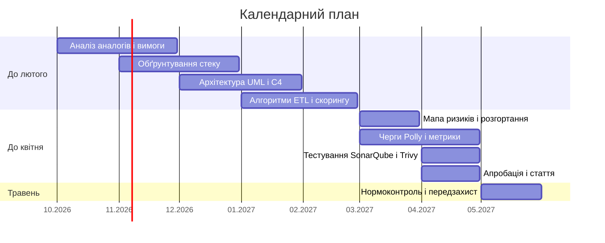

# 🚀 F2_Diploma_Zon_Nazar_Vadymovych — PKM Workspace

## 📌 Паспорт проєкту

| Параметр                | Значення                                                                                                                               |
| :---------------------- | :------------------------------------------------------------------------------------------------------------------------------------- |
| **Студент**             | Зонь Назар Вадимович                                                                                                                   |
| **Науковий керівник**   | Валь Олександ Олександрович                                                                                                            |
| **Спеціальність**       | F2 Інженерія програмного забезпечення                                                                                                  |
| **Освітній рівень**     | Бакалавр                                                                                                                               |
| **Назва проєкту (укр)** | Інформаційна система автоматизованого виявлення аномалій та оцінки ризиків у публічних закупівлях для відбудови інфраструктури України |
| **Назва проєкту (eng)** | Automated Anomaly Detection and Risk Assessment Information System in Public Procurement for Ukraine's Infrastructure Reconstruction   |
| **Репозиторій Git**     | [F2-Diploma_project](https://github.com/BabayVolohatyu/F2-Diploma_project)                                                             |

---

## 📅 Календарний план 

| № з/п | Назва етапу кваліфікаційної роботи | Термін виконання етапів проєкту | Примітка / Статус виконання |
| :---: | :--- | :---: | :---: |
| 1 | Аналіз аналогів і вимоги за ДСТУ | Жовтень – листопад 2026 | To Do — Аналоги і ТЗ |
| 2 | Обґрунтування стеку | Листопад – грудень 2026 | To Do — Вибір стеку |
| 3 | Архітектура UML/C4 і схеми PostgreSQL, Neo4j, Redis | Грудень 2026 – січень 2027 | To Do — UML, C4, бази |
| 4 | Алгоритми ETL, графа, скорингу і блокування задач | Січень – лютий 2027 | To Do — Закрити в лютому |
| 5 | Мапа ризиків і схема розгортання | Березень 2027 | To Do — Інтерфейс і Docker |
| 6 | Черги, Polly, Hangfire/Quartz, метрики | Березень – квітень 2027 | To Do — Інфраструктура |
| 7 | Тестування, SonarQube і Trivy | Квітень 2027 | To Do — Закрити в квітні |
| 8 | Апробація і стаття | Квітень 2027 | To Do — Стаття |
| 9 | Нормоконтроль і передзахист | Травень 2027 | To Do — Лише перевірка оформлення |

---

## 📚 Репозиторій артефактів & Посилання

- [[04_Scientific_Apparatus|Науковий апарат проєкту]]
- [[05_Analog_Engineering|Інженерний опис аналогів]]
- [[01_Thesis_Proposal|📄 Переглянути Thesis Proposal]]
- [[02_AI_Insights|🤖 Протокол AI Disclosure (AI Insights)]]
- [[03_Supervisor_Feedback|💬 Фідбек наукового керівника]]